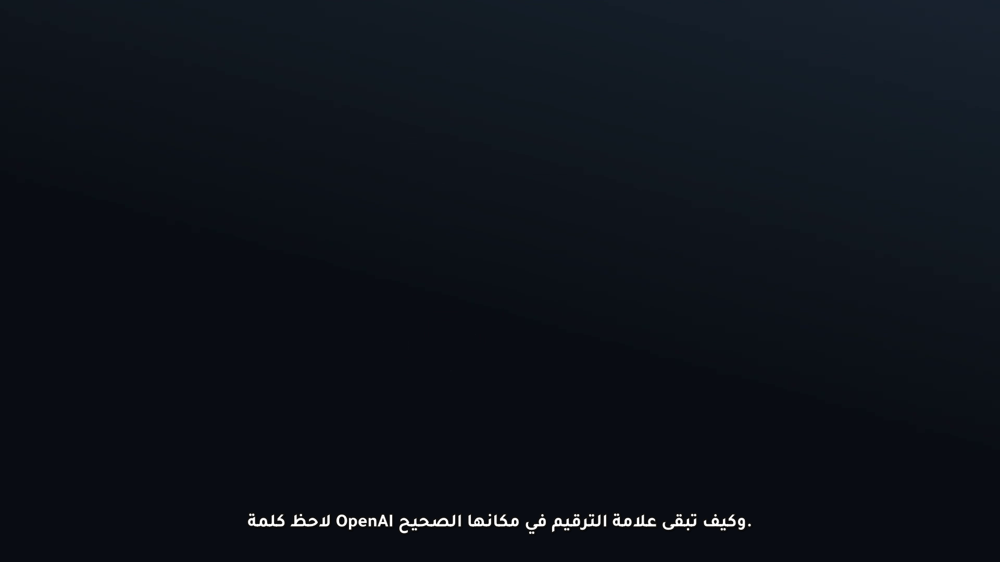

# sard · سرد

[](https://github.com/majdvik/sard/actions/workflows/ci.yml)
[](LICENSE)
[](pyproject.toml)

A subtitle safety layer for Arabic and other right-to-left languages. `sard` repairs
bidi-ambiguous cue text, wraps lines by the **measured pixel width** of the actual font,
and exports ASS for burn-in or SRT that DaVinci Resolve can import without flipping the
text around.

[شاهد العرض التوضيحي](docs/demo.mp4) · [الشرح بالعربية ↓](#بالعربية)



## The problem

Subtitle engines decide paragraph direction from the first strong character. A cue that
starts with a Latin product name inside an Arabic sentence (for example `OpenAI …`) is
therefore rendered left-to-right, punctuation moves to the wrong edge, and line breaks
counted in characters overflow the title-safe area once the font is applied.

## What sard does

1. **Diagnose** — `sard check` reports mixed-direction cues, Latin-led Arabic lines,
   unbalanced brackets, existing bidi controls, and missing glyphs for a given font.
2. **Repair conservatively** — inserts U+200F RIGHT-TO-LEFT MARK only where the base
   direction is at risk (Latin-led or Latin-trailing cues), removes stale controls first,
   and is idempotent.
3. **Wrap by measured width** — uses Pillow to measure the exact font and pixel size,
   then chooses a balanced 1–3 line split that fits the safe width. No character counting.
4. **Export** — ASS with `WrapStyle: 2` and `{\q2}` (no renderer auto-wrap), safe margins,
   RTL-aware text; or SRT with UTF-8 BOM for Resolve's subtitle track.
5. **Verify visually** — `sard frame` and `sard burn` render through FFmpeg/libass so you
   can inspect the real shaping before delivery.

## Install

```bash
git clone https://github.com/majdvik/sard.git
cd sard
python -m pip install -e ".[full]"
```

Requires Python 3.10+, Pillow, and FFmpeg on `PATH` for `burn`/`frame`.
`fonttools` (the `full` extra) is used for family names and glyph coverage.

## Usage

```bash
# Diagnose a file
sard check subtitles.srt --font "C:/Windows/Fonts/tahoma.ttf"

# Arabic SRT -> Resolve-ready SRT (UTF-8 BOM, measured wrapping)
sard convert subtitles.srt -o subtitles.rtl.srt --target srt

# Arabic SRT -> ASS for burn-in
sard convert subtitles.srt -o subtitles.ass --font assets/Tajawal-Bold.ttf

# Burn or preview one frame
sard burn clip.mp4 subtitles.srt -o clip_captioned.mp4 --font assets/Tajawal-Bold.ttf
sard frame clip.mp4 subtitles.srt -o qa.png --at 4.8 --font assets/Tajawal-Bold.ttf
```

Useful flags: `--width/--height` (default 1920×1080), `--max-lines` (default 2),
`--bidi marks|isolates|off`, `--base auto|rtl|ltr`, `--measure font|heuristic`,
`--margin-lr/--margin-v`, `--font-size`.

## How it works

| Stage | Module | Behaviour |
| --- | --- | --- |
| Parse | `sard.subs` | SRT/VTT, BOM, CRLF, cue settings, HTML tags, UTF-8/CP1256 fallback |
| Direction | `sard.bidi` | first-strong rule, RTL override for Latin-led Arabic lines, RLM repair |
| Layout | `sard.layout` | balanced dynamic-programming wrap over measured widths |
| Export | `sard.ass` | ASS header/style/events, override sanitation, safe margins |
| Render | `sard.burn` | FFmpeg burn-in and single-frame QA |

## Resolve workflow

Resolve's subtitle track imports SRT, not styled ASS. Use `--target srt` for that track;
the repaired text and measured line breaks survive the import. Use the ASS output only
for FFmpeg burn-in or players that render ASS. See [docs/RESOLVE.md](docs/RESOLVE.md).

## Evidence

- 51 automated tests (`pytest`), including bidi edge cases, wrapping, ASS escaping, CLI
  round-trips, and a real FFmpeg render test.
- Demo rendered on Windows 11 with Python 3.11.9, FFmpeg 9.0.2 (libass), Tajawal Bold.
- The screenshot above is `sard frame` output at 4.8 s — the trailing period sits on the
  left edge of the RTL line and `OpenAI` keeps its Latin order.

## Limitations

- Not a transcriber: pair it with Whisper/faster-whisper for speech-to-text.
- Arabic shaping quality depends on the font and the renderer; `check --font` only warns
  about missing glyphs, not about shaping coverage.
- Karaoke/word-level highlighting and ASS styling import into Resolve are not supported.
- The `isolates` mode (LRI/PDI) is available but not the default, because some older
  renderers ignore isolates.

## License

MIT © 2026 Majd Abdelrahim

---

## بالعربية

**سرد** طبقة سلامة للترجمة العربية قبل التسليم: يصلح اتجاه النص، ويقسّم الأسطر حسب عرض
الخط الفعلي، ويصدّر SRT جاهز لـ DaVinci Resolve أو ASS جاهز للحرق.

**المشكلة:** محرّكات الترجمة تستنتج الاتجاه من أول حرف قوي. سطر عربي يبدأ باسم لاتيني
مثل `OpenAI` ينقلب إلى LTR، فتنتقل علامة الترقيم للجهة الغلط، والتقسيم بعدد الحروف
يخرج عن الإطار الآمن بعد تطبيق الخط.

**ما تفعله الأداة:**

1. `sard check` يكشف الاتجاه المختلط، البداية اللاتينية داخل نص عربي، الأقواس غير
   المتوازنة، والمحارف الناقصة في الخط.
2. إصلاح محافظ: يضيف علامة RLM فقط عند الحاجة، ويحذف أي محارف اتجاه قديمة أولاً.
3. تقسيم بالعرض الفعلي: يقيس النص بنفس الخط والحجم عبر Pillow، ويختار تقسيمة متوازنة
   بسطرين (أو حتى ثلاثة عند الطلب).
4. تصدير ASS بهوامش آمنة و`WrapStyle: 2`، أو SRT بترميز UTF-8 BOM لمسار الترجمة في
   Resolve.
5. `sard frame` و`sard burn` للتحقق البصري عبر FFmpeg/libass قبل التسليم.

**التشغيل:**

```bash
python -m pip install -e ".[full]"
sard convert subtitles.srt -o subtitles.rtl.srt --target srt
sard frame clip.mp4 subtitles.srt -o qa.png --at 4.8 --font assets/Tajawal-Bold.ttf
```

**حدود واضحة:** الأداة لا تفرّغ الصوت (استخدم Whisper)، ولا تستورد أنماط ASS داخل
Resolve (استخدم SRT هناك)، والتشكيل العربي يعتمد على الخط والمحرك.

الترخيص MIT.
